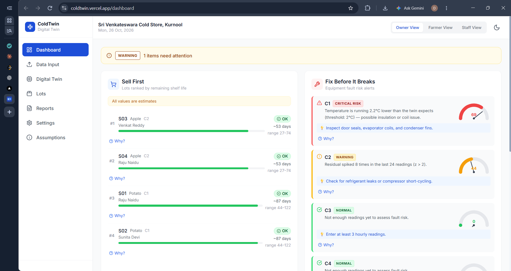
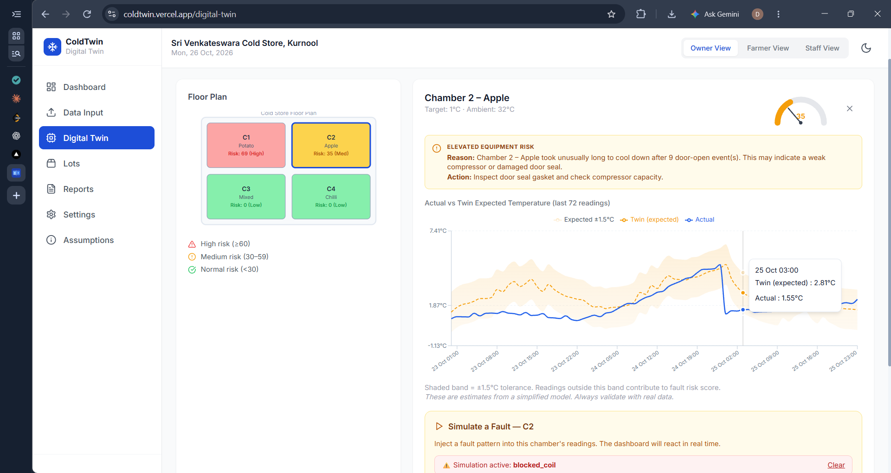
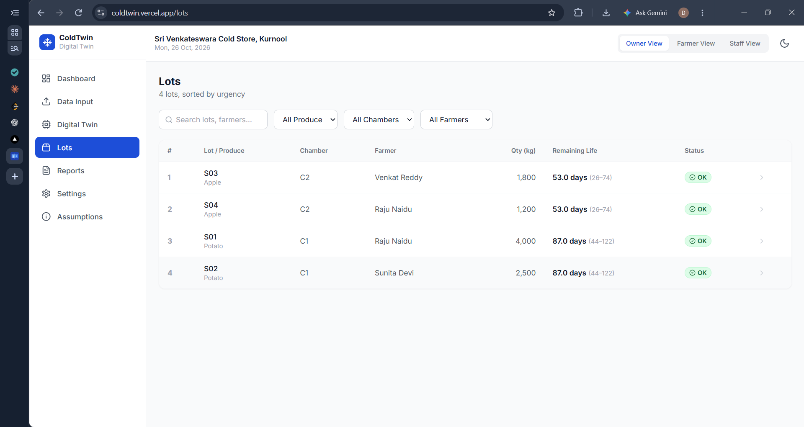
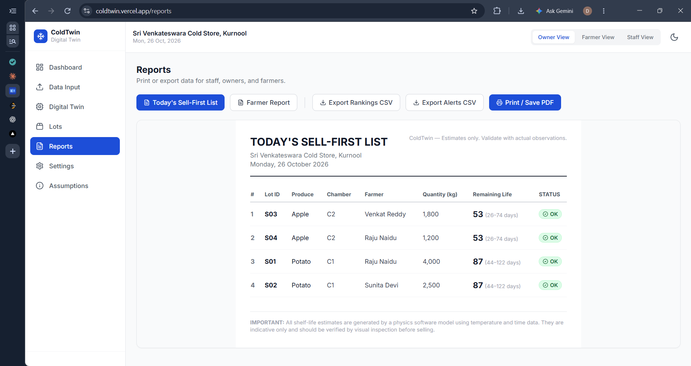

# ColdTwin: a software-first digital twin for small cold stores

**Live demo:** https://coldtwin.vercel.app/


> **Status: working prototype on demo data.** All numbers you see come from synthetic data and illustrative crop settings. Nothing here has been validated on a real cold store yet.

## The problem

Small and medium cold stores lose produce and electricity in two everyday ways:

1. **Faults are noticed too late.** A dirty coil, a door left open or a compressor that keeps switching on and off looks like nothing at first. The owner finds out only after the temperature has risen and produce is damaged.
2. **Stock is sold by arrival date, not freshness.** Two lots in the same store can age at different speeds depending on the temperature and humidity they have been through, so some produce is sold too late.

Commercial monitoring tools mostly sound an alarm after a limit is crossed, and they cost lakhs of rupees, which is out of reach for a small owner.

## The idea

ColdTwin turns records a store already has (temperature logs, arrival dates, crop types) into two daily decisions:

- **What to sell first**
- **What to fix before it breaks**

No hardware is needed to start. Staff upload a CSV/Excel file or type in daily readings. The app only reads data and never controls any equipment.

## Try it in 2 minutes

1. Open the live demo link above.
2. Go to **Data Input** and click **Load demo data**.
3. Open the **Dashboard**: read the **Sell First** list and the **Fix Before It Breaks** card, and click **Why?** to see the explanation.
4. Open **Digital Twin**, select a chamber, and press **Simulate a Fault** (for example *Blocked coil*). Watch the actual temperature leave the expected band and the risk score rise. Press **Clear** to reset.
5. Open **Reports** and try **Print / Save as PDF** for the one-page daily list.
6. Try the language switch (English / Telugu / Hindi) in **Settings**.

You can also test your own data: use the files in [`sample-data/`](sample-data/) on the **Upload** tab (see below).

## Screenshots

| Dashboard | Digital Twin (fault simulated) |
|---|---|
|  |  |

| Lots | Daily report |
|---|---|
|  |  |

## Features

- **Sell First list:** lots ranked by estimated remaining shelf life, shown as a range with a red/amber/green tag and a "Why?" explanation.
- **Fix Before It Breaks:** a 0 to 100 fault-risk score per chamber with a plain-language reason and suggested action.
- **Digital twin:** the software predicts what each chamber's temperature should be and compares it with the actual reading.
- **Fault simulator:** inject a blocked coil, an open door or compressor short-cycling to see the early warning react.
- **Energy waste estimate:** extra compressor run-time converted into kWh and rupees.
- **Lots page:** search and filter every lot, with a shelf-life curve and uncertainty band.
- **Reports:** printable one-page Sell First list, a per-farmer lot report, and CSV export.
- **Data input:** CSV/Excel upload, manual entry forms and downloadable templates.
- **Languages:** English, Telugu and Hindi for the main labels.
- **Honesty built in:** a "Demo data" badge, an Assumptions page, and every prediction shown as an estimate.

## How it works (in plain English)

All calculations live in [`src/engine`](src/engine) and use transparent rules and statistics, not a black box.

1. **Thermal twin:** a simple model of each chamber (heat leaking in, cooling from the compressor, heat from door openings) predicts the expected temperature.
2. **Fault score:** compares actual with expected, checks how slowly the chamber recovers after a door opens, and looks for compressor overwork or rapid on/off cycling. These are combined into a 0 to 100 risk score with reasons.
3. **Shelf life:** each lot starts at full freshness and uses it up faster when conditions are warm or humid. The result is a range, not a single exact number.
4. **Ranking and energy:** lots are sorted by remaining life to give the Sell First list, and extra compressor hours are converted into energy cost.

## Using your own data

Go to **Data Input**, open the **Templates** tab, and download the templates, or use the ready-made files in `sample-data/`:

- `sample_readings.csv`: 3 days of hourly readings for two chambers (the second shows a slow drift, like a blocked coil).
- `sample_lots.csv`: four example lots.

Upload the lots file and the readings file in the **Upload** tab. For a clean test, clear the demo data first (Settings), then upload the lots file followed by the readings file.
## Tech stack

React, TypeScript, Vite, Tailwind CSS, Recharts, Zustand, PapaParse and SheetJS. The app runs entirely in the browser, and data is saved in the browser's local storage.

## Run locally

```bash
npm install
npm run dev      # opens at http://localhost:5173
npm test         # runs the engine unit tests
npm run build    # production build
```

## Project structure

```
src/
  engine/     thermal twin, fault detection, shelf life, ranking, energy, demo data (+ tests)
  pages/      Dashboard, Data Input, Digital Twin, Lots, Reports, Settings, Assumptions
  components/ cards, charts and layout
  store/      app state (Zustand)
  i18n/       English, Telugu, Hindi strings
sample-data/  example CSV files
docs/         screenshots
```

## Limitations (please read)

- **All data is synthetic.** Nothing has been tested on a real cold store.
- **Crop settings are illustrative placeholders.** Ideal temperatures, humidity and base shelf lives must be validated with real data and experts.
- **Estimates only.** No accuracy figures are claimed. Predictions are shown with uncertainty.
- **No server or login yet.** Data stays in one browser. The Owner / Farmer / Staff switch is a demo and is not real access control.
- **Read-only by design.** The software analyses data and never controls equipment.
- **Translations are partial.** Main labels are translated, but some messages are still English only.

## Roadmap

- Pilot with a real cold store to validate the models against actual records
- Learned per-chamber "normal pattern" (statistical anomaly detection)
- WhatsApp access: daily Sell First message and simple commands (planned, not built)
- Real login with server-enforced roles so farmers only see their own lots
- Optional sensor gateway for automatic data collection
- Voice and photo input (read a logbook photo, answer questions in Telugu)
## Team

**Team 15**, Chaitanya Bharathi Institute of Technology
*Seva First Innovation Challenge*

- K. Ram Sri Varun
- K. Ramith
- D. Rishwanth
- G. Deekshith